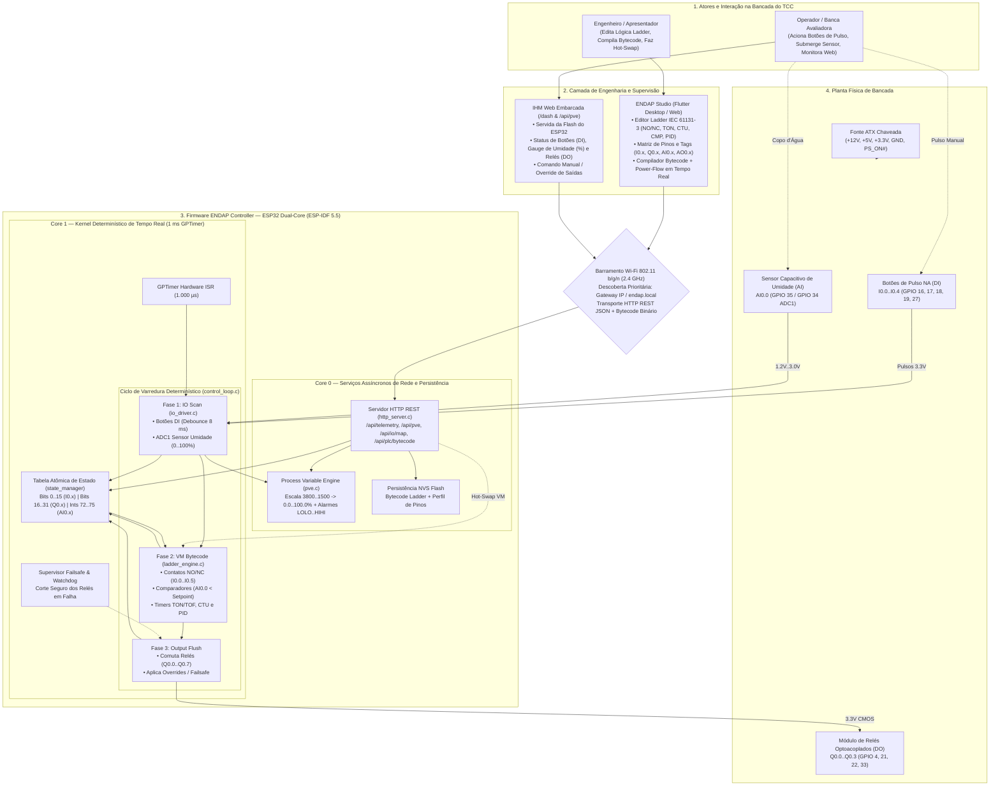
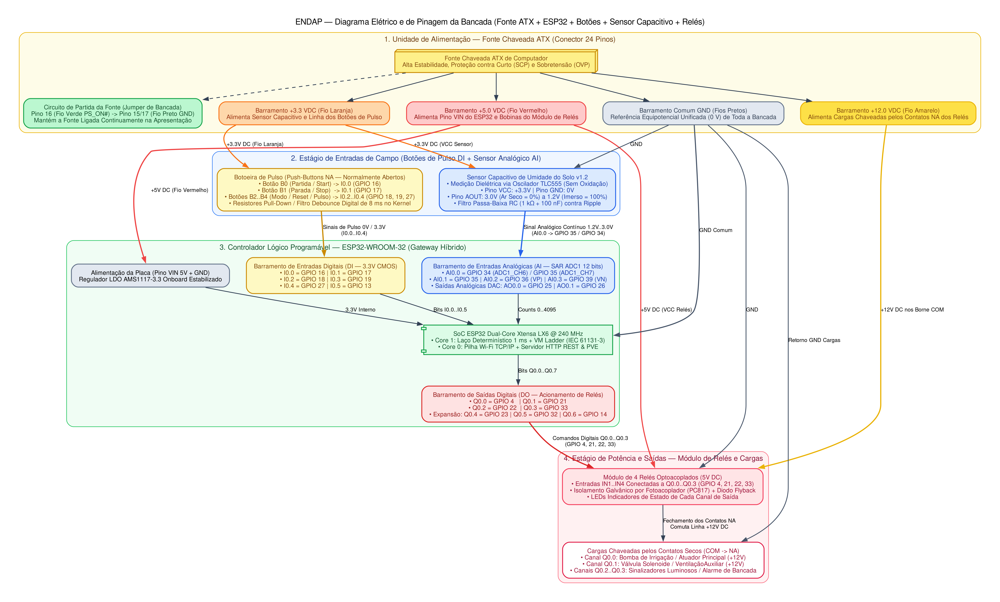
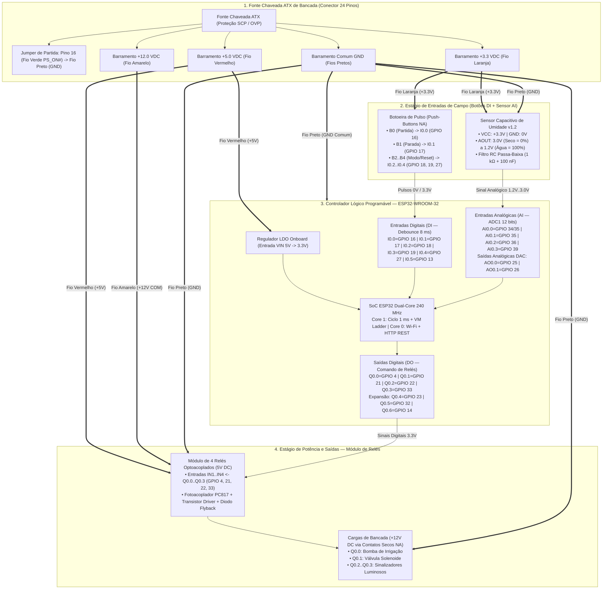

# Estrutura e Arquitetura da Solução ENDAP — Bancada de Demonstração do TCC

> **Documento de Especificação Técnica e Projeto de Engenharia**  
> **Produto:** ENDAP (*Edge-Native Distributed Automation Platform*)  
> **Escopo da Bancada:** 1x ESP32 (Controlador / Gateway Híbrido), Wi-Fi padrão, Botoeira de Pulso nas Entradas Digitais (`DI`), Sensor Capacitivo Analógico de Umidade (`AI`), Módulo de Relés nas Saídas Digitais (`DO`) e Alimentação por Fonte ATX  
> **Finalidade:** Composição do Relatório Final de Conclusão de Curso (TCC) / Documentação de Engenharia do Produto  

---

## 1. Introdução e Contextualização da Bancada Experimental

Para a validação experimental e demonstração perante a banca examinadora do Trabalho de Conclusão de Curso (TCC), o **ENDAP** (*Edge-Native Distributed Automation Platform*) foi estruturado em uma bancada eletroeletrônica industrial compacta e auto-suficiente. O propósito é comprovar na prática o **determinismo temporal rígido do Kernel de 1 ms**, a **execução da Máquina Virtual de Bytecode Ladder (IEC 61131-3)** e a **supervisão em tempo real via Wi-Fi**, operando sobre entradas digitais a pulso, transdução analógica capacitiva e estágio de potência a relé.

### Componentes Principais da Montagem Atual:
1. **Unidade Controladora Central (ESP32 Gateway Híbrido):**
   - **Core 1 (Tempo Real Estrito — 1 ms):** Dedicado exclusivamente ao ciclo determinístico disparado por interrupção de hardware (`GPTimer` a 1.000 µs), realizando a leitura com *debounce* dos botões de pulso, a amostragem e interpolação do sensor de umidade, a avaliação das redes (*rungs*) de lógica Ladder e o chaveamento imediato dos relés.
   - **Core 0 (Comunicação e Supervisão Assíncrona):** Gerencia a pilha Wi-Fi TCP/IP, o servidor HTTP REST (`/api/telemetry`, `/api/pve`, `/api/io/map`, `/api/plc/bytecode`), a recepção a quente (*Hot-Reload*) de programas compilados pelo **ENDAP Studio** e a interface web embarcada (`/dash`).
2. **Botões de Pulso (Push-Buttons NA) nas Entradas Digitais (`DI`):**
   - Botoeiras normalmente abertas (NA) conectadas às entradas digitais `I0.0..I0.4` (`GPIO 16, 17, 18, 19, 27`), permitindo simular comandos industriais clássicos de painel: **Partida Manual (Start)**, **Parada/Emergência (Stop)**, **Selo Lógico** e **Reset de Contadores/Alarmes**.
   - Cada pino passa por um filtro digital determinístico de *debounce* de 8 amostras consecutivas (8 ms) dentro do `io_driver.c`, eliminando repiques mecânicos de contato.
3. **Sensor Capacitivo Analógico de Umidade (`AI`):**
   - Transdutor capacitivo de umidade do solo (v1.2) imune à corrosão galvânica, conectado à entrada analógica `AI0.0` (`ADC1` nos pinos `GPIO 35` / `GPIO 34`).
   - O sinal analógico contínuo (de ~3.0 V no ar seco até ~1.2 V imerso em água) é convertido em contagens de 12 bits (`0..4095`) e interpolado linearmente pelo firmware (`3800 counts -> 0%` a `1500 counts -> 100%`), alimentando tanto a variável `AI0.0` (`%IW0.0`) do Ladder quanto o *Process Variable Engine* (`PVE`).
4. **Módulo de Relés Optoacoplados nas Saídas Digitais (`DO`):**
   - As saídas digitais `Q0.0..Q0.3` (`GPIO 4, 21, 22, 33`) e canais de expansão `Q0.4..Q0.7` (`GPIO 23, 32, 14, 13`) acionam relés eletromecânicos com isolamento óptico (`PC817`) e diodo de roda-livre (*flyback*), comutando cargas em +12V DC (bomba de irrigação, válvula solenoide e sinalizadores luminosos).
5. **Fonte Chaveada ATX de Bancada:**
   - Fornece todos os barramentos regulados de corrente contínua necessários para a planta: **+3.3 VDC** (fios laranjas — sensor capacitivo e linha de pulso dos botões), **+5.0 VDC** (fios vermelhos — alimentação `VIN` do ESP32 e bobinas dos relés), **+12.0 VDC** (fios amarelos — cargas de potência chaveadas pelos contatos NA dos relés) e **GND Comum** (fios pretos), ativada por jumper no pino 16 (`PS_ON#`).

---

## 2. Diagrama 1: Arquitetura de Software e Fluxo de Execução

O diagrama abaixo representa a arquitetura completa de software do ENDAP, detalhando a separação entre os núcleos do ESP32 (`Core 0` vs. `Core 1`), o ciclo determinístico de 1 ms e a integração com os botões de pulso, sensor capacitivo e relés.

### 2.1. Imagem de Alta Resolução (300 DPI)

*(Versão vetorial SVG disponível em: [`./assets/diagrama_software_endap.svg`](./assets/diagrama_software_endap.svg))*

---

### 2.2. Diagrama Estrutural de Software (Mermaid)

---

## 3. Diagrama 2: Arquitetura Elétrica e Pinagem Completa da Bancada

O diagrama elétrico abaixo detalha as ligações físicas entre a **Fonte ATX**, a **Botoeira de Pulso (Entradas Digitais)**, o **Sensor Capacitivo de Umidade (Entrada Analógica)**, o **ESP32-WROOM-32** e o **Módulo de Relés (Saídas Digitais)**.

### 3.1. Imagem de Alta Resolução (300 DPI)

*(Versão vetorial SVG disponível em: [`./assets/diagrama_eletrico_endap.svg`](./assets/diagrama_eletrico_endap.svg))*

---

### 3.2. Diagrama Elétrico de Ligações (Mermaid)

---

## 4. Tabela Consolidada de Mapeamento de Hardware da Bancada

| Tipo | Tag CLP | Endereço IEC | Pino ESP32 | Função Elétrica na Bancada | Condicionamento / Tratamento no Firmware |
| :--- | :--- | :--- | :--- | :--- | :--- |
| **DI** | `I0.0` | `%IX0.0` | `GPIO 16` | Botão de Pulso NA 1 (Partida / Limiar Digital) | Filtro de *debounce* determinístico de 8 ms (`io_driver.c`) |
| **DI** | `I0.1` | `%IX0.1` | `GPIO 17` | Botão de Pulso NA 2 (Parada / Emergência) | Filtro de *debounce* determinístico de 8 ms (`io_driver.c`) |
| **DI** | `I0.2` | `%IX0.2` | `GPIO 18` | Botão de Pulso NA 3 (Seleção Automático/Manual) | Filtro de *debounce* determinístico de 8 ms (`io_driver.c`) |
| **DI** | `I0.3` | `%IX0.3` | `GPIO 19` | Botão de Pulso NA 4 (Reset de Alarmes/Contadores) | Filtro de *debounce* determinístico de 8 ms (`io_driver.c`) |
| **DI** | `I0.4` | `%IX0.4` | `GPIO 27` | Botão de Pulso NA 5 (Pulso de Contagem `CTU`) | Filtro de *debounce* determinístico de 8 ms (`io_driver.c`) |
| **DI** | `I0.5` | `%IX0.5` | `GPIO 13` | Entrada Digital Auxiliar 6 | Filtro de *debounce* determinístico de 8 ms (`io_driver.c`) |
| **AI** | `AI0.0` | `%IW0.0` | `GPIO 34` / `35` | Sensor Capacitivo de Umidade (`AOUT`) | `ADC1` 12 bits (`3800..1500` counts $\rightarrow$ `0..100%`) |
| **AI** | `AI0.1` | `%IW0.1` | `GPIO 35` | Entrada Analógica 2 (`ADC1_CH7`) | `ADC1` 12 bits + Escalonamento `PVE` (`AIN2`) |
| **AI** | `AI0.2` | `%IW0.2` | `GPIO 36` (`VP`) | Entrada Analógica 3 (`ADC1_CH0`) | `ADC1` 12 bits (`0..4095`) |
| **AI** | `AI0.3` | `%IW0.3` | `GPIO 39` (`VN`) | Entrada Analógica 4 (`ADC1_CH3`) | `ADC1` 12 bits (`0..4095`) |
| **DO** | `Q0.0` | `%QX0.0` | `GPIO 4` | Relé 1 (Bomba Principal de Irrigação) | Isolamento Óptico + Escrita Atômica Fase 3 (`1 ms`) |
| **DO** | `Q0.1` | `%QX0.1` | `GPIO 21` | Relé 2 (Válvula Solenoide / Auxiliar) | Isolamento Óptico + Escrita Atômica Fase 3 (`1 ms`) |
| **DO** | `Q0.2` | `%QX0.2` | `GPIO 22` | Relé 3 (Sinalizador de Operação) | Isolamento Óptico + Escrita Atômica Fase 3 (`1 ms`) |
| **DO** | `Q0.3` | `%QX0.3` | `GPIO 33` | Relé 4 (Alarme Luminoso / Sonoro) | Isolamento Óptico + Escrita Atômica Fase 3 (`1 ms`) |
| **DO** | `Q0.4..Q0.6`| `%QX0.4..0.6` | `GPIO 23, 32, 14` | Saídas Digitais de Expansão | Escrita Atômica Fase 3 (`1 ms`) |
| **AO** | `AO0.0..0.1`| `%QW0.0..0.1` | `GPIO 25, 26` | Saídas Analógicas DAC 8 bits (`0..3.3V`) | Conversor Digital-Analógico Nativo (`DAC1` / `DAC2`) |
